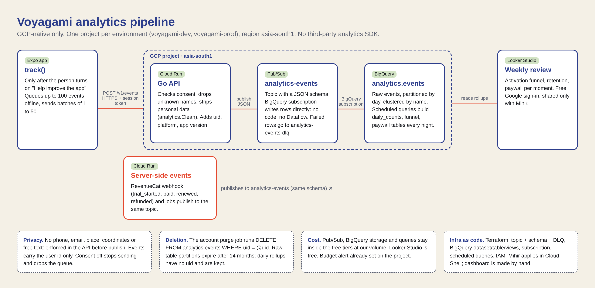

# Product analytics

Events go from the app to the API, which checks them and publishes them to Pub/Sub. A BigQuery subscription writes them into `analytics.events`; nightly scheduled queries build rollup tables that a Looker Studio report reads. Everything stays in our own Google Cloud project. No third-party analytics SDK.

- Event list, properties, context and funnels: [the VOY-224 sheet](https://docs.google.com/spreadsheets/d/1vyrppzTQZqM03b-aFLito65Yf6gXGaU1cXuUFrU7iQM/edit). The allow-list in code is `analytics.Names` (services/api) and `apps/mobile/src/analytics/events.ts`; keep the three in step.
- Infrastructure: `infra/modules/analytics` (VOY-229). The diagram source is `diagrams/analytics-pipeline.html`.

## Rules

- The app sends nothing until the person turns on **Help improve the app** in Privacy. Turning it off stops sending at once and drops anything still waiting.
- Events carry a name, a time and a few short properties. Never a phone number, a place, a trip name or any free text.
- Properties are short fixed words, ids, numbers or booleans.
- The server drops any name not on the list.

## Server checks (`POST /v1/events`)

- Kept only for people whose `analytics` consent is `granted` (`GET /v1/me/consents`). Without it the whole batch is dropped and the reply says so.
- A batch has 1 to 50 events. An event older than 7 days or more than 5 minutes in the future is dropped.
- At most 10 properties per event, with `camelCase` names. A value is an identifier (letters, digits, `_ . : -`, up to 64 characters), a number or a boolean. Free text has spaces, so it cannot get in.
- A property whose name contains `phone`, `email`, `name`, `address`, `lat`, `lng`, `lon`, `location`, `text`, `note`, `message` or `token` is dropped. It is a substring match, so `platform` or `latency` cannot be property names either.
- The batch's `context` (sessionId, platform, osVersion, appVersion, appLanguage) must be identifiers too; anything else is blanked. The server adds the person's plan and home country.

## Rows

One row per event in `analytics.events`, partitioned by day and kept 14 months. Columns: `eventId, name, eventTime, receivedTime, uid, sessionId, platform, osVersion, appVersion, appLanguage, plan, homeRegion, source, props`. `props` is JSON text: `JSON_VALUE(props, '$.moment')`. Without `ANALYTICS_TOPIC` (local dev) the API only logs how many events arrived.

## Server events

The API itself records: `trial_started`, `subscription_started`, `trip_pass_bought`, `paid`, `subscription_renewed`, `subscription_cancelled`, `purchase_refunded` (store notifications), `limit_reached` (the entitlements service said no) and `ask_draft_created`. With the person's analytics consent these carry their id and properties; without it they are counted with neither (decided 2026-11-02, so revenue counts are complete).

## Account deletion

When an account is purged, the API publishes an `account_purged` row with that id and an anonymous `account_deleted`. The nightly purge query deletes every row of an id that has an `account_purged` row, the marker included.

## Weekly review

Rollup tables, rebuilt at 01:00 UTC, no ids in them:

| Table               | What                                                                                                                                         |
| ------------------- | -------------------------------------------------------------------------------------------------------------------------------------------- |
| `daily_counts`      | events and people per day, name and platform                                                                                                 |
| `activation_funnel` | per signup week, people who ever reached each step: install, sign-in, first trip, invite sent, crew joined, first expense, trial start, paid |
| `paywall_daily`     | shown, dismissed and converted per day and moment                                                                                            |
| `weekly_retention`  | people opening the app N weeks after their first week                                                                                        |

Connect Looker Studio to these tables (see infra/README.md). The old `GET /v1/jobs/analytics-report` is gone.

## Defaults chosen for the open questions (2026-11-02)

- Billing events without consent: counted without id.
- `screen_viewed`: on every route (cheap in BigQuery).
- Raw rows kept 14 months; rollups kept.
